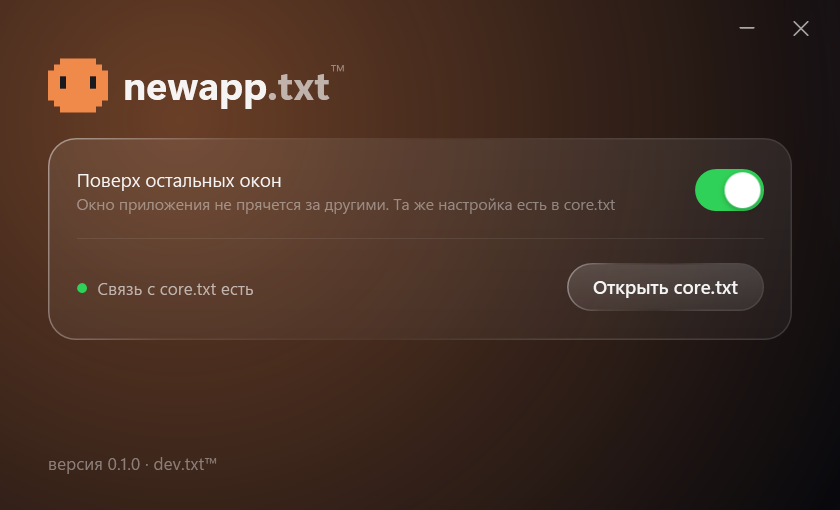

# newapp.txt

Заготовка следующего приложения dev.txt™ на C# и WPF. С первого коммита оно выглядит как остальные и подключено к хабу core.txt.



Что уже есть:

- окно в общем виде: свечение за стеклом, шапка со значком и названием `newapp.txt™`, стеклянный блок с переключателем и кнопкой — всё из общих элементов;
- связь с хабом через `HubLink`: приложение отдаёт настройки в тему `newapp.settings` (один переключатель для примера), принимает `settings.set` и `show`, слушает `hub.theme` и включает «Меньше движения» вместе со всеми;
- работа без хаба: core.txt не запущен — приложение работает само и тихо пробует подключиться снова;
- сборка встроенным в Windows компилятором и выпуск релиза по тегу.

## Что переименовать

Имя встречается в трёх написаниях. Замените каждое — с учётом регистра — во всех файлах, кроме общих (`src/Tokens.cs`, `src/Ui.cs`, `src/HubLink.cs`):

| Было | Что это | Пример |
|---|---|---|
| `NewApp` | имя файла и процесса, пространство имён | `Dock` → `Dock.exe`, `DevTxt.Dock` |
| `newapp` | имя в хабе, в каталоге core.txt, в папке настроек и в названии `newapp.txt™` | `dock` |
| `NEWAPP` | переменные окружения для проверок | `DOCK_HUB_PORT`, `DOCK_DATA` |

Где именно:

- [ ] `build.ps1` — `$name = 'NewApp'`, `$product = 'newapp.txt'`, упоминание `assets\newapp.ico`
- [ ] `src/Program.cs` — `Id = "newapp"`, `Name = "NewApp"`, `namespace DevTxt.NewApp`, `NEWAPP_DATA`, первые строки с описанием
- [ ] `src/AppHub.cs` — `namespace DevTxt.NewApp`, `NEWAPP_HUB_PORT`, первая строка
- [ ] `src/MainWindow.cs` — `namespace DevTxt.NewApp`, первая строка
- [ ] `.github/workflows/build.yml` — `NewApp.exe`, `NewApp.exe.sha256`, заголовок релиза
- [ ] `.gitignore` — `NewApp.exe`
- [ ] `README.md` и `CLAUDE.md` — название и примеры
- [ ] `docs/screenshot.png` — переснять: `--demo --shot docs\screenshot.png`

Проверка: поиск `newapp` без учёта регистра ничего не находит, сборка проходит, `--selftest` завершается с кодом 0.

Имя в хабе — строчные латинские буквы, цифры и дефис, начинается с буквы, не длиннее 32 знаков; имя `hub` занято. Файл программы называется просто `Dock.exe`, без `.txt`.

## Сборка

```bash
powershell -ExecutionPolicy Bypass -File build.ps1
```

Ничего ставить и скачивать не нужно. Получается один файл `NewApp.exe`. Номер версии — в `version.txt`.

## Проверка

```bash
./NewApp.exe --selftest
./NewApp.exe --demo --shot shot.png
```

| Ключ | Что делает |
|---|---|
| `--selftest` | проверяет описание настроек, `settings.set`, чтение `hub.theme`, запись настроек и работу без хаба |
| `--demo` | выдуманное состояние; хаб, диск и сеть не трогаются |
| `--shot файл.png` | рисует окно в файл и выходит; на экране ничего не появляется |
| `--headless` | запуск без окна: только связь с хабом |

Проверка связи без настоящего core.txt — с образцовым хабом из kit.txt на свободном порту:

```bash
node путь/к/kit.txt/hub/hub.js 48962
NEWAPP_HUB_PORT=48962 NEWAPP_DATA=./tmp-data ./NewApp.exe --headless
```

`NEWAPP_HUB_PORT` — порт хаба вместо 42080, `NEWAPP_DATA` — папка настроек вместо `%APPDATA%\dev.txt\newapp`. Вторая сторона — `hub/client.js`: подписаться на `newapp.settings`, послать `settings.set`.

## Как это устроено

| Файл | Что это |
|---|---|
| `src/Program.cs` | запуск, ключи, настройки (`Prefs`), самопроверка |
| `src/MainWindow.cs` | окно |
| `src/AppHub.cs` | связь с хабом: описание настроек, команды, общий вид |
| `src/Tokens.cs`, `src/Ui.cs`, `src/HubLink.cs` | **копии из kit.txt, руками не правятся** |
| `tools/sync.ps1` | заново копирует эти три файла из kit.txt |

```bash
powershell -ExecutionPolicy Bypass -File tools\sync.ps1 путь\к\kit.txt
```

Новая настройка добавляется в трёх местах: поле в `Prefs` (и его запись с чтением), строка в `AppHub.Settings()` и ветка в `AppHub.Apply()`. Виды настроек — `switch`, `choice`, `slider`, `action` — описаны в `hub/PROTOCOL.md` из kit.txt. В общую страницу стоит выносить то, что меняют часто; редкое может остаться в окне приложения.

## Значок

Значок — рисунок из крупных пикселей: строки из `.` (пусто), `#` (тело) и `E` (глаз). Один оранжевый цвет, тёмный вертикальный глаз, прозрачный фон. Все строки одной длины; у существующих значков она 10–12, строк — 8–12.

```
..######..
.########.
##########
##E####E##
##E####E##
##########
##########
.########.
..######..
```

1. Нарисуйте свой и замените `Sprite` в `src/MainWindow.cs`.
2. Добавьте его под именем приложения в `icons/sprites.json` в kit.txt и запустите там `node tools/icons.js` — в `dist/icons` появятся PNG и ICO.
3. Положите полученный `.ico` в `assets/` — `build.ps1` сделает его значком файла. Без него сборка тоже проходит.
4. Те же строки пойдут в каталог core.txt — см. ниже.

## Как попасть в core.txt

Одной записью в `catalog.json` репозитория core.txt:

```json
{
  "id": "newapp",
  "name": "NewApp",
  "tagline": "Одна строка о том, что это",
  "color": "#F08A4B",
  "kind": "portable",
  "repo": "cxxperman/newapp",
  "asset": "NewApp.exe",
  "exe": "NewApp.exe",
  "process": "NewApp",
  "sprite": ["..######..", ".########.", "##########", "##E####E##", "##E####E##", "##########", "##########", ".########.", "..######.."]
}
```

- `repo` — только репозитории владельца `cxxperman`.
- `asset` — имя файла в релизе; версия берётся из тега вида `v1.2.3`.
- Релиз делает `.github/workflows/build.yml`: поставьте номер в `version.txt` и отправьте тег `v` с тем же номером. В релиз попадают `NewApp.exe` и `NewApp.exe.sha256`.

После этого core.txt ставит, обновляет и запускает приложение, а его настройки появляются на общей странице, как только оно подключится к хабу.

## Правила экосистемы

1. Цвета, радиусы, размеры шрифта и длительности берутся из токенов (`Tokens.cs`), а не пишутся числом в коде.
2. Приложение работает и без хаба, и без остальных приложений.
3. Всё, что приложение сообщает наружу, идёт через хаб, а не через собственный порт.
4. `Tokens.cs`, `Ui.cs` и `HubLink.cs` копируются из kit.txt как есть и руками не правятся.
5. Название пишется строчными с подписью: `newapp.txt™`. У продукта свой пиксельный значок.
6. Кнопки, переключатели и карточки берутся из общих элементов (`Ui.cs`), а не рисуются заново.

И ещё три — из протокола хаба: состояние присылается целиком, после переподключения повторяется (это делает `HubLink`), существующие поля не меняют смысла.
